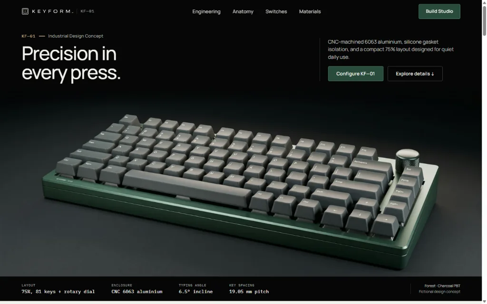
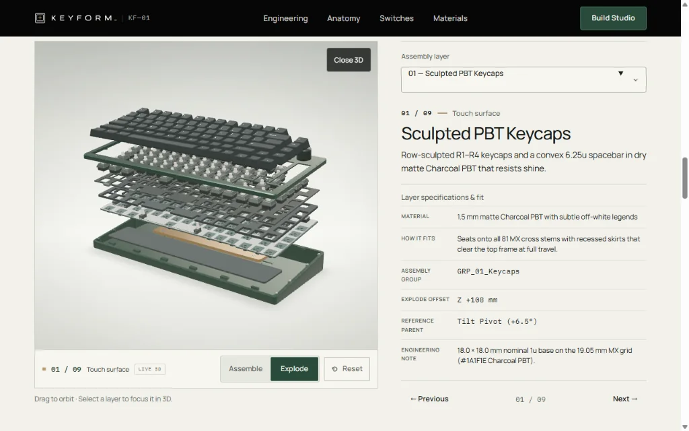
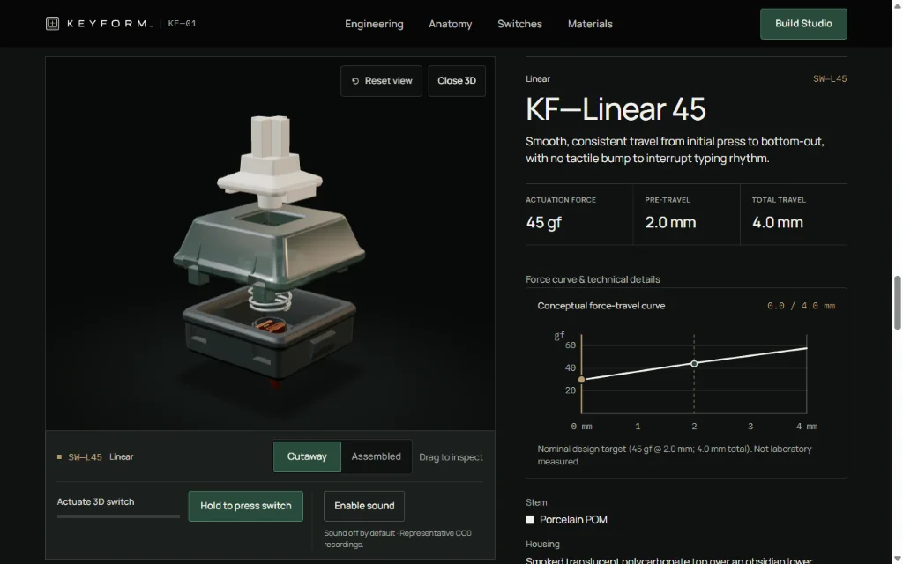
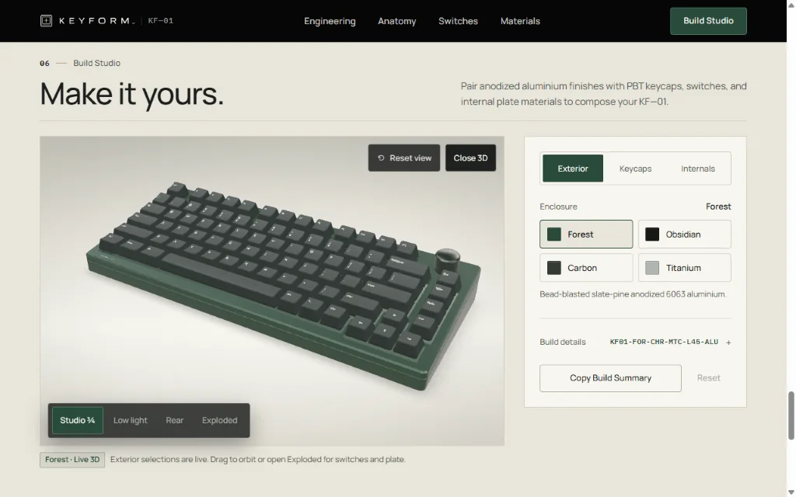
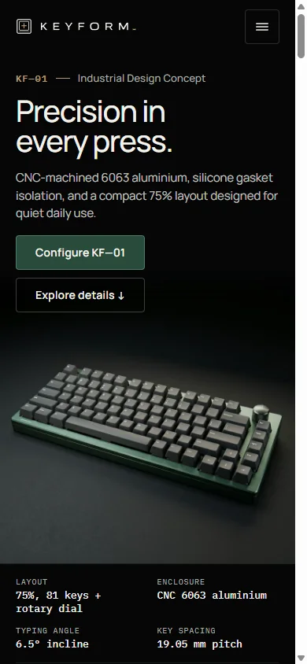

# KEYFORM — KF—01

**An interactive 3D industrial design showcase for a fictional 75% CNC-machined mechanical keyboard.**

[](https://keyform-lake.vercel.app)
[](https://react.dev/)
[](https://www.typescriptlang.org/)
[](https://threejs.org/)
[](https://vite.dev/)

**Live website:** [https://keyform-lake.vercel.app](https://keyform-lake.vercel.app)

KEYFORM is a Creative Frontend and 3D Web Engineering portfolio project presenting **KF—01**, a fictional 75% ANSI gasket-mount mechanical keyboard modeled from scratch in Blender and rendered on the web with native Three.js. It pairs art-directed Cycles editorial photography with three demand-driven WebGL stations—**Mechanical Anatomy**, **Switch Lab**, and **Build Studio**—under a single shared renderer lease.

> **Fictional Concept Disclosure:** KEYFORM and KF—01 are fictional industrial design concepts created for design and engineering portfolio review. All imagery and 3D views are computer-rendered; no commercial availability, manufacturing, certification, or laboratory acoustic testing is implied. Verified mechanical standards (19.05 mm Cherry MX pitch, 14.0 mm plate cutout, 1.5 mm plate, 1.6 mm PCB) are explicitly separated from conceptual KF—01 specifications throughout the experience.



---

## Key Capabilities

- **Static-First Editorial Delivery:** Responsive AVIF/WebP studio photography (`OR13` desktop, `OR14` mobile) paints immediately with zero initial WebGL, GLB, or audio network requests.
- **Single-Renderer Lease & Conditional 3D:** Three interactive Three.js stations share a single WebGL renderer that activates automatically after sustained eligible visibility, with explicit `View in 3D` / `Close 3D` controls and static photography fallbacks for reduced motion, `Save-Data`, constrained networks, or low-memory devices.
- **9-Layer Mechanical Anatomy:** Exploded assembly inspection from sculpted PBT keycaps through switches, plate, acoustic layers, PCB, and CNC bottom chassis, with non-destructive layer focus, Z-buffered architectural ghosting, and spherical non-clipping camera transitions.
- **Interactive Switch Lab & Opt-In Audio:** Standalone 3D switch inspection (`Cutaway` / `Assembled`), pointer and keyboard (`Space`/`Enter`) stem actuation with spring compression, synchronized nominal force-travel SVG curves, and an opt-in Web Audio engine powered by recorded CC0-1.0 mechanical switch samples.
- **Real-Time Build Studio:** Live PBR configuration across 4 anodized enclosures (`Forest`, `Obsidian`, `Carbon`, `Titanium`), 3 keycap sets (`Charcoal PBT`, `Porcelain PBT`, `Two-Tone Slate`), 4 Escape key accents, 3 switch profiles, and 4 internal plate materials—with deterministic WCAG-contrast legend tinting, camera presets, and copyable build codes.
- **Demand-Driven Rendering & Budget Discipline:** Elapsed-time orbit damping and explode animations settle cleanly to zero idle GPU frames; initial JS stays under `90 KB` gzip and the lazy native 3D runtime stays under `200 KB` gzip.

---

## Visual Tour

### Mechanical Anatomy — 9-Layer Exploded Stack

Inspect all nine internal sub-assemblies (`GRP_01_Keycaps` through `GRP_09_BottomChassis`) with synchronized layer focus, elapsed-time explode easing, and technical fit disclosures.



### Switch Lab — 3D Cutaway, Actuation & Opt-In Audio

Compare `KF—Linear 45`, `KF—Tactile 58`, and `KF—Silent 50` with a standalone 3D cutaway switch, real-time stem travel and spring compression, synchronized force-travel curves, and gesture-gated CC0 audio previews.



### Build Studio — Real-Time 3D Configurator

Compose enclosure finishes, keycap sets, Escape accents, switch profiles, and internal plate materials in real time. Internal GLB partitions load lazily only when switching to `Rear` or `Exploded` views.



### Responsive Mobile Presentation

Art-directed `1:1` mobile hero photography (`OR14`), touch-sized controls (`44×44 px` minimum targets), and height-gated sticky viewport behavior tailored for small screens.

<p align="center">
  
</p>

---

## Technology Stack

| Layer | Implementation |
| :--- | :--- |
| **Frontend** | React 19, TypeScript 5.8, Vite 6, plain CSS with semantic design tokens (`--kf-*`) |
| **Typography** | Self-hosted `Manrope Variable` and `IBM Plex Mono` (SIL OFL 1.1 via `@fontsource`) |
| **3D Modeling & Renders** | Custom Blender master (`KF—01`), Cycles OptiX editorial renders exported to responsive AVIF/WebP |
| **WebGL Runtime** | Native Three.js `0.180.0` (lazy-loaded), `EXT_meshopt_compression` GLB partitions, instanced 81-keycap geometry, 1024/2048 legend mask atlases |
| **Audio Engine** | Framework-independent Web Audio engine (`src/audio/`) playing 18 SHA-256 verified CC0-1.0 mono WAV samples on explicit user opt-in |
| **Hosting** | Vercel static hosting with immutable asset caching and scoped MIME headers (`vercel.json`) |

---

## Technical Architecture

KEYFORM is a client-only static application with no backend, database, authentication, or checkout flow:

```text
src/
├── components/sections/   # 7 editorial & interactive sections (Hero → Closing)
├── components/ui/         # Accessible controls, responsive <picture>, fallbacks
├── data/                  # Canonical KF—01 spec, anatomy layers, BuildConfig schema
├── runtime/
│   ├── rendererLease.ts   # Exclusive single WebGL renderer ownership & cancellation
│   ├── capabilities.ts    # Reduced-motion, Save-Data, network, and memory gating
│   ├── ViewportHost.tsx   # Crossfade static-to-3D lifecycle & static error recovery
│   └── three/             # Native Three.js stage, instancing, PMREM studio, legend shader
├── audio/                 # Lazy, opt-in CC0 recorded sample provider & Web Audio engine
└── styles/                # Design tokens, Swiss grid layout, restrained motion rules
```

**Core architectural patterns:**

1. **Zero-WebGL Initial Paint:** The visitor entry chunk (`~90 KB` gzip) renders the complete editorial page using static AVIF/WebP photography. Three.js, Meshopt decoding, and GLB payloads are dynamically imported only when a 3D station activates.
2. **Exclusive Renderer Lease:** Only one `WebGLRenderer` instance exists at any time across Mechanical Anatomy, Switch Lab, and Build Studio. Claiming a new station synchronously aborts in-flight loads, disposes GPU resources, and restores static photography on the previous station.
3. **Partitioned Asset Loading:** The exterior keyboard shell loads first; internal mechanical assemblies (`GRP_03_Switches` through `GRP_09_BottomChassis`) fetch lazily when the visitor enters `Exploded` or `Rear` views.
4. **Demand Loop:** `NativeStage` renders frames only during pointer/keyboard orbit, damping settle, explode tweens, switch actuation, or material updates—dropping to `0` GPU frames at idle.

For full architectural context and geometry specifications, see [docs/ARCHITECTURE.md](docs/ARCHITECTURE.md), [docs/PRODUCT_SPEC.md](docs/PRODUCT_SPEC.md), and [docs/ASSET_PIPELINE.md](docs/ASSET_PIPELINE.md).

---

## Local Development & Verification

Requires **Node.js 22.x** (`package.json` `engines.node: "22.x"`).

### Install & Run Locally

```bash
npm ci
npm run dev
```

### Typecheck, Build & Preview Production Bundle

```bash
npm run typecheck
npm run build
npm run preview
```

Open `http://127.0.0.1:4185/` to inspect the built `dist/` output locally.

### Quality & Verification Suites

With `npm run preview` running on `http://127.0.0.1:4185/`, run the verification scripts:

```bash
npm run verify:assets             # SHA-256, byte size, MIME, and 404 check across all 172 assets
npm run verify:browser            # Multi-viewport layout, OR13/OR14 exclusivity, 0 initial WebGL/audio
npm run verify:runtime            # Single-renderer lease, abort/disposal, context loss, idle-zero
npm run verify:runtime -- --strict # React StrictMode lifecycle verification
npm run verify:mechanics          # Hardware picking, 4.0 mm travel, explode timing, draw-call ceilings
npm run verify:kf005              # 9-layer Anatomy focus, Switch Lab actuation, opt-in audio checks
npm run verify:kf006a             # Build Studio live material bindings & legend contrast checks
npm run verify:kf008b             # Conditional automatic 3D activation & manual priority checks
```

---

## Deployment

Production deploys automatically from `main` to Vercel (`https://keyform-lake.vercel.app`) via `npm run build` (`dist/`):

- [vercel.json](vercel.json) enforces `no-cache` on HTML and `favicon.svg`, `public, max-age=31536000, immutable` on hashed bundles, media, GLBs, and audio, `model/gltf-binary` on `.glb`, `image/avif` / `image/webp` on `/media/kf-008a/`, and `audio/wav` scoped strictly to `/audio/kf01-v2/(.*\.wav)` so `manifest.json` serves `application/json`.
- [.vercelignore](.vercelignore) excludes documentation (`docs/`), tests (`tests/`), and local working directories from production uploads.

---

## Known Limitations

- **Synthetic vs. Field Telemetry:** Performance budgets and CLS/LCP checks were verified on headless and CDN probes rather than real-user CrUX field telemetry.
- **WebGL2 Dependency:** Live 3D stations require client WebGL2 support. Unsupported browsers, reduced-motion preferences, `Save-Data`, or constrained devices intentionally remain on high-resolution static photography.
- **External 3D Masters:** Source `.blend` files and uncompressed raw render masters are intentionally excluded from Git and maintained in an external asset workspace.
- **Representative Audio Preview:** Switch Lab audio uses curated CC0-1.0 real-world keyboard recordings as representative previews (including a provisional lubed linear mapping for `KF—Silent 50`), not laboratory recordings of a physical KF—01 unit.

---

## Asset Provenance, Attribution & License

- **Verified Shipped Assets:** All **172** shipped runtime, image, and audio assets are SHA-256 verified in [tests/production-asset-inventory.json](tests/production-asset-inventory.json).
- **Audio Samples (CC0 1.0):** All 18 mono `44.1 kHz` 16-bit WAV samples in `public/audio/kf01-v2/` derive from public-domain **CC0-1.0** Freesound recordings. Full source attribution and disclosures are documented in [docs/AUDIO_SOURCES.md](docs/AUDIO_SOURCES.md) and [docs/THIRD_PARTY_NOTICES.md](docs/THIRD_PARTY_NOTICES.md).
- **Fonts & Dependencies:** `Manrope` and `IBM Plex Mono` are licensed under **SIL OFL 1.1**; `Three.js` (including `MeshoptDecoder`), `React`, and `Vite` are licensed under the **MIT License**.
- **Repository License Status:** No top-level open-source license (`LICENSE`) is currently included in this repository. Source code and original visual assets are publicly visible for portfolio inspection only; all rights are reserved by the author unless otherwise stated in [docs/THIRD_PARTY_NOTICES.md](docs/THIRD_PARTY_NOTICES.md).

---

## Engineering Documentation

- [Product Specification](docs/PRODUCT_SPEC.md) — Verified MX standards vs. conceptual KF—01 dimensions and materials
- [Architecture](docs/ARCHITECTURE.md) — Information architecture, hybrid media strategy, and performance budgets
- [Asset Pipeline](docs/ASSET_PIPELINE.md) — Blender coordinate conventions, naming contracts, and 9-layer hierarchy
- [Development Roadmap](docs/ROADMAP.md) — Milestone history from KF-001 through the KF-011 production release
- [Phase Handoff Log](docs/HANDOFF.md) — Detailed engineering decisions, verification evidence, and rollback records
- [Audio Sources](docs/AUDIO_SOURCES.md) & [Third-Party Notices](docs/THIRD_PARTY_NOTICES.md) — Sample provenance and dependency licenses
